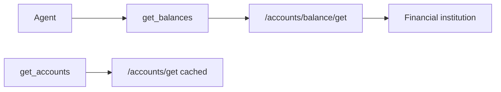

# Plaid MCP: `get_balances`

**Target release:** 0.0.2 (after 0.0.1)  
**Depends on:** [initial server](initial-server.md) (shipped)  
**Created:** 2026-10-10

## Checklist

- [x] `PlaidGateway.accounts_balance_get` → `/accounts/balance/get`
- [x] `PlaidFinance.get_balances` reuses `_account_view` (same account JSON shape as `get_accounts`)
- [x] MCP tool `get_balances` in `make_tools()`
- [x] Extend `FakeGateway` / `FakePlaidApi`; add `tests/test_finance.py` and `tests/test_client.py` coverage
- [x] `tests/test_server.py` registers the new tool
- [x] Bump `0.0.2`, CHANGELOG, `AGENTS.md`, `docs/finance.md`, README overview
- [x] `compose.yaml` image tag `0.0.2`; rebuild container; **Cursor reload** before agent calls the tool

## Goal

Expose **live** balance data from Plaid **`/accounts/balance/get`** so agents can read **`available`** and **`current`** when the institution provides them at request time.

Today **`get_accounts`** calls **`/accounts/get`**, which returns **cached** balances. Production Capital One checking often shows **`current`** but **`available: null`**. Live balance fetch is the supported path for PFM-style “what can I spend now?” when the bank sends **`available`**.



## In scope

- One new read-only MCP tool: **`get_balances`**
- Same **`item_id`** semantics as existing finance tools (optional → default item)
- Optional filter to one or more **`account_id`** values (Plaid request options)
- Response account objects match **`get_accounts`** (including **`balances.current`**, **`balances.available`**, **`balances.limit`**, **`balances.isoCurrencyCode`**)
- Optional per-account **`lastUpdatedDatetime`** when Plaid sends `balances.last_updated_datetime` (ISO 8601 string in JSON)

## Out of scope

- Changing **`get_accounts`** behavior or removing it (cached snapshot stays useful and cheap)
- Adding **`balance`** to **`/link/token/create`** products (Plaid forbids; Balance is used via **`/accounts/balance/get`** with existing products — **transactions** + **liabilities** at link time is unchanged)
- **`/signal/evaluate`** (ACH risk / Signal Rules)
- Webhooks, investments, recurring, **`list_items`**, server introspection (separate plans if needed)
- **`min_last_updated_datetime`** for Capital One non-depository accounts in v1 (document workaround below; add parameter in a follow-up if production errors require it)

## Tool contract

**Name:** `get_balances`

**Parameters:**

| Parameter | Purpose |
| --- | --- |
| `item_id` | Optional. Omit to use the default linked item. Blank string is an error. Unknown id is an error. |
| `account_ids` | Optional list of Plaid **`account_id`** strings. Omit to refresh all accounts on the item. Empty list is an error. |

**Plaid API:** `POST /accounts/balance/get` with the item **`access_token`**. When **`account_ids`** is set, pass it in request **options** (Plaid **`AccountsBalanceGetRequestOptions.account_ids`**).

**Returns:**

```json
{
  "itemId": "item-id",
  "accounts": [
    {
      "accountId": "account-id",
      "name": "360 Checking",
      "officialName": "360 Checking",
      "type": "depository",
      "subtype": "checking",
      "mask": "5261",
      "lastUpdatedDatetime": "2026-10-10T18:00:00Z",
      "balances": {
        "current": 1196.2,
        "available": 1150.0,
        "limit": null,
        "isoCurrencyCode": "USD"
      }
    }
  ]
}
```

**Notes for agents and users:**

- **`available`** may still be **`null`** if the institution does not calculate it (Plaid documents this). Live fetch improves freshness of **`current`**; it does not guarantee **`available`**.
- **Credit “available to spend”** still depends on **`limit`** and liability data; this tool only returns account **`balances`** from balance/get.
- **Capital One credit cards:** Plaid may require **`min_last_updated_datetime`** for non-depository accounts. If production returns **`INVALID_FIELD`** for that case, use **`get_accounts`** / **`get_liabilities`** for card context until a follow-up adds the optional datetime parameter, or refresh depository accounts only via **`account_ids`**.

**Errors (`PlaidMcpError` or Plaid SDK errors surfaced consistently with existing tools):**

- No linked items, missing default, unknown **`item_id`**, blank **`item_id`**
- Blank or invalid **`account_ids`** entries (non-string or empty after trim)
- Empty **`account_ids`** list
- Missing credentials (same as other tools)
- Plaid API errors (invalid token, item login required, institution down) — same handling pattern as **`get_accounts`**

## Implementation

1. **`plaid_mcp/client.py`**
   - Import **`AccountsBalanceGetRequest`** and **`AccountsBalanceGetRequestOptions`**.
   - Add **`accounts_balance_get(access_token, account_ids: list[str] | None)`** on **`PlaidGateway`**.

2. **`plaid_mcp/finance.py`**
   - Add **`get_balances(item_id=None, account_ids=None)`**.
   - Validate **`account_ids`** when provided (list of non-blank strings).
   - Map response with existing **`_account_rows`** / extend **`_account_view`** to include **`lastUpdatedDatetime`** from **`balances.last_updated_datetime`** when present ( **`get_accounts`** omits this field for unchanged shape except new optional key only on balance/get responses — acceptable; or add to both when present on cached accounts for consistency).

3. **`plaid_mcp/server.py`**
   - Register **`get_balances`** in **`make_tools()`** with docstring stating live balance vs cached **`get_accounts`**.

4. **Tests**
   - **`tests/fakes.py`:** **`accounts_balance_get`** on **`FakeGateway`**; **`accounts_balance_get`** on **`FakePlaidApi`**.
   - **`tests/test_client.py`:** request wiring with and without **`account_ids`**.
   - **`tests/test_finance.py`:** success, validation errors, optional datetime on account view.
   - **`tests/test_server.py`:** tool exists and delegates.

5. **Docs**
   - **`docs/finance.md`:** new section for **`get_balances`**, comparison table with **`get_accounts`**.
   - **`docs/overview.md`:** tool list.
   - **`README.md`:** one line on live balances.

**Reuse:** Share **`_account_view`**; only **`get_balances`** responses include **`lastUpdatedDatetime`** when Plaid sends it (simplest v1 — avoids changing **`get_accounts`** contract).

## Tests and coverage

100% line and branch coverage on **`plaid_mcp`** (no new omit/pragmas).

```bash
python -m coverage run --branch -m pytest
python -m coverage report --fail-under=100
```

## Ship checklist

- [ ] **`CHANGELOG.md`** heading **`0.0.2`**
- [ ] **`pyproject.toml`** and **`plaid_mcp/__init__.py`** **`__version__`** → **`0.0.2`**
- [ ] **`AGENTS.md`** tool list includes **`get_balances`** (and remove “Do not add tools beyond this list” stale line — replace with explicit allowed set of four read tools)
- [ ] **`compose.yaml`** / **`docs/docker.md`** image tag **`0.0.2`**
- [ ] Rebuild and restart Docker; Quincy **reloads Cursor** so **`get_balances`** appears in the MCP catalog

## Verify after ship

1. **`get_balances`** with default **`item_id`** on production Capital One depository accounts — compare **`available`** / **`current`** to Capital One app when possible.
2. **`get_balances`** with **`account_ids`** set to one checking **`accountId`** from **`get_accounts`**.
3. Confirm **`get_accounts`** unchanged (cached path still works).
